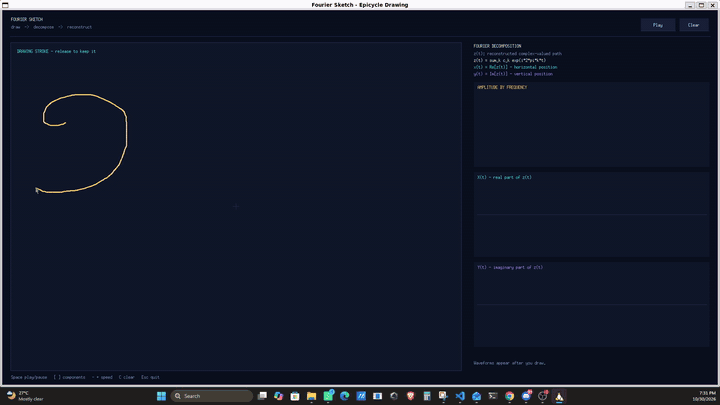

# Fourier Sketch

Fourier Sketch is an interactive C++17/X11 program that converts freehand mouse
strokes into complex discrete Fourier series and visualizes their reconstruction
as chains of rotating epicycles. It also displays the active frequency spectrum
and the reconstructed horizontal and vertical coordinate functions in real time.

Each disconnected stroke is processed independently. The strokes share one
animation clock, but each has its own samples, Fourier coefficients, epicycle
chain, and pen-up return interval. This keeps disconnected marks visually
separate while allowing all of them to animate together.

## Demo

[](assets/FourierSketch-Demo.mp4)

Click the animated preview to open the full-resolution video presentation.

## Requirements

- A C++17 compiler
- CMake 3.16 or newer
- Xlib development headers and an X11 display

On Ubuntu or WSL:

```bash
sudo apt update
sudo apt install build-essential cmake libx11-dev
```

WSL2 with WSLg supplies an X11-compatible display automatically. On an older
WSL installation, start an external Windows X server and set `DISPLAY` before
running the program. The application also runs on a Linux desktop with X11.

## Build and run

```bash
cmake -S . -B build -DCMAKE_BUILD_TYPE=Release
cmake --build build -j
./build/fourier-sketch
```

The CMake project builds three targets:

- `fourier_core`, the sampling and Fourier-math library
- `fourier-sketch`, the X11 application
- `fourier-tests`, the math test executable

## Controls

- Click and drag in the canvas to record a stroke; release and drag again to add
  disconnected strokes.
- Click **Play** after sketching to leave collection mode and begin animation.
- Use **Space** or **Play/Pause** to pause and resume.
- Drag the purple slider, press **[** or **Down**, or press **]** or **Up** to
  change the number of active Fourier terms.
- Press **-** or **+** to change the speed between 0.25x and 4x.
- Press **C**, **R**, or **Clear** to discard the drawing.
- Press **Esc** to exit.

The faint path is the normalized source stroke, cyan is the truncated Fourier
reconstruction, the circles show coefficient magnitudes, and the attached
vectors show their current complex values. After animation starts, dragging the
canvas again resumes collection and adds another stroke to the existing drawing.

## From pointer samples to a periodic signal

The program represents a screen point as a complex number

$$
z = x + iy, \qquad x = \mathrm{Re}(z), \qquad
y = \mathrm{Im}(z).
$$

While the pointer is down, a point is retained only after it is at least two
pixels from the preceding point. Raw event density still depends on pointer
speed, so directly transforming those events would give slowly drawn regions
more weight. The math layer instead parameterizes each polyline by cumulative
arc length. For vertices $p_0,p_1,\ldots,p_{P-1}\in\mathbb{C}$, it computes

$$
s_0 = 0, \qquad
s_j = s_{j-1} + \lvert p_j-p_{j-1}\rvert,
\quad 1\le j<P.
$$

Here $s_j$ is the distance traveled along the polyline rather than the straight
line distance from its beginning. For a requested distance
$d\in[s_{j-1},s_j]$, the containing segment is linearly interpolated using

$$
u = \frac{d-s_{j-1}}{s_j-s_{j-1}}, \qquad
p(d) = (1-u)p_{j-1}+up_j, \qquad 0\le u\le1.
$$

For the $Q$ visible samples produced for a stroke by `resampleStrokes`, the
target distances are uniformly spaced over the total arc length $L=s_{P-1}$:

$$
d_q = \frac{qL}{Q-1}, \qquad q=0,1,\ldots,Q-1.
$$

The UI requests 256 timeline samples per stroke. With the current ten-sample
return interval, 246 samples cover the visible stroke, including both endpoints,
and ten samples interpolate from its end toward its beginning. Those return
samples are tagged pen-up. They make the data approximately periodic for the
DFT without drawing an artificial closing line in the reconstructed trace.
For endpoints $p_{\mathrm{end}}$ and $p_{\mathrm{start}}$ and $T=10$ return
samples, those transition points are

$$
r_\ell=\left(1-\frac{\ell}{T+1}\right)p_{\mathrm{end}}
+\frac{\ell}{T+1}p_{\mathrm{start}},
\qquad \ell=1,2,\ldots,T.
$$

Before decomposition, all raw strokes in a drawing share a single centroid. For
$R$ total retained pointer points, that centroid is

$$
\mu = \frac{1}{R}\sum_{r=0}^{R-1}p_r.
$$

If the canvas has width $W$ and height $H$, define the centered extents

$$
E_x = \max\left(1,\max_r\lvert\mathrm{Re}(p_r-\mu)\rvert\right),
\qquad
E_y = \max\left(1,\max_r\lvert\mathrm{Im}(p_r-\mu)\rvert\right).
$$

The implementation applies the uniform scale

$$
\alpha = \min\left(\frac{0.43W}{E_x},\frac{0.43H}{E_y}\right),
\qquad \widetilde p_r = \alpha(p_r-\mu).
$$

Thus the full centered extent occupies at most $86\%$ of either canvas
dimension, while the uniform factor $\alpha$ preserves the drawing's aspect
ratio. Resizing the window repeats this normalization and decomposition from the
retained raw data.

The reusable `resampleStrokes` function can also construct one timeline from
multiple polylines. It allocates at least two visible samples to each nondegenerate
stroke, distributes the remaining visible-sample budget in proportion to arc
length using largest remainders, inserts fixed-size pen-up transitions, and adds
a final transition back to the first stroke. The current UI calls it separately
for each stroke, which is why every stroke receives its own Fourier chain.

## Discrete Fourier decomposition

Let the normalized timeline contain $N$ complex samples $z_n$, sampled at
$t_n=n/N$. For integer spatial frequency $k$, the program computes

$$
c_k = \frac{1}{N}\sum_{n=0}^{N-1}
z_n\exp\left(-i2\pi k\frac{n}{N}\right).
$$

This is the normalized complex DFT. At most 101 coefficients are calculated for
each 256-sample stroke. They are stored in the low-frequency epicycle order

$$
\mathcal K_{101}=(0,+1,-1,+2,-2,\ldots,+50,-50).
$$

The ordering is a presentation choice rather than a different transform. Taking
a prefix adds positive and negative frequencies in pairs, so increasing the term
count introduces progressively finer spatial detail. The UI uses odd term counts
to keep those pairs balanced and initially enables 31 terms.

The zero-frequency coefficient is the mean of the sampled trajectory:

$$
c_0 = \frac{1}{N}\sum_{n=0}^{N-1}z_n.
$$

It positions an epicycle chain relative to the canvas center. The spectrum plot
therefore omits the DC bar and shows the shape-producing frequencies more
clearly. For multiple strokes, the plot sums coefficient magnitudes at matching
stored frequencies.

## Reconstruction and epicycles

For normalized animation time $t\in[0,1)$, a prefix of $M$ coefficients is
evaluated as

$$
z_M(t)=\sum_{k\in\mathcal K_M}c_k e^{i2\pi kt}.
$$

Writing $c_k=a_k+ib_k$ and $\theta_k=2\pi kt$, Euler's identity gives

$$
\begin{aligned}
c_ke^{i\theta_k}
&=(a_k+ib_k)(\cos\theta_k+i\sin\theta_k) \\
&=(a_k\cos\theta_k-b_k\sin\theta_k)
 +i(a_k\sin\theta_k+b_k\cos\theta_k).
\end{aligned}
$$

Therefore the displayed coordinate functions are

$$
\begin{aligned}
x_M(t)&=\mathrm{Re}(z_M(t))
=\sum_{k\in\mathcal K_M}
\left(a_k\cos\theta_k-b_k\sin\theta_k\right), \\
y_M(t)&=\mathrm{Im}(z_M(t))
=\sum_{k\in\mathcal K_M}
\left(a_k\sin\theta_k+b_k\cos\theta_k\right).
\end{aligned}
$$

Consequently, the side graphs are not separate transforms: they are the real and
imaginary parts of the same complex series. In polar form,

$$
c_k=\lvert c_k\rvert e^{i\phi_k}, \qquad
c_ke^{i2\pi kt}=\lvert c_k\rvert e^{i(2\pi kt+\phi_k)},
\qquad \phi_k=\arg(c_k).
$$

Each epicycle therefore has radius $\lvert c_k\rvert$, initial angle $\phi_k$,
and signed angular velocity $2\pi k$ per normalized cycle. Positive and negative
frequencies rotate in opposite directions. Adding the vectors head-to-tail gives
$z_M(t)$, and the last endpoint produces the cyan trace. Parseval's identity for
the full $N$-term transform also relates spatial energy to coefficient energy:

$$
\frac{1}{N}\sum_{n=0}^{N-1}\lvert z_n\rvert^2
=\sum_{k=0}^{N-1}\lvert c_k\rvert^2.
$$

The animation update is

$$
t\leftarrow\left(t+\frac{v\,\Delta t}{8}\right)\bmod 1,
$$

where $v$ is the selected speed multiplier and $\Delta t$ is elapsed wall-clock
time in seconds. At 1x speed, one normalized cycle therefore lasts approximately
eight seconds. The program samples the reconstruction once per roughly 16 ms
frame. A trace segment is drawn only when both adjacent timeline states are
pen-down, which hides the
periodic return. All stroke chains use the same `t`, so their motion stays
synchronized. The trace is cleared when the time wraps or the active component
count changes.

## Implementation layout

- `src/Fourier.hpp` declares the complex sample, component, resampling,
  decomposition, and evaluation interfaces.
- `src/Fourier.cpp` implements arc-length resampling, multi-stroke timeline
  allocation, the direct DFT, and truncated-series evaluation. Decomposition is
  `O(NM)` for `N` samples and `M` retained coefficients; evaluation is `O(M)`.
- `src/main.cpp` owns X11 events, drawing collection, normalization, animation,
  double-buffered rendering, epicycles, plots, and controls.
- `tests/FourierTests.cpp` contains dependency-free checks for the math layer.

Rendering uses an off-screen X11 pixmap and copies the completed frame to the
window, reducing flicker. The event loop processes pending X11 events, advances
the shared steady-clock time, renders, and then waits approximately 16 ms.

## Tests

Configure and build the project first, then run:

```bash
ctest --test-dir build --output-on-failure
```

The current tests check frequency ordering, exact reconstruction of a sampled
circle, arc-length interpolation, multi-stroke sampling, and pen-up labels for
inter-stroke travel.

## Numerical and modeling notes

- Calculations use double-precision `std::complex<double>` values.
- Degenerate strokes and empty inputs are ignored; a path containing one point
  can be replicated by `resamplePath`, but the UI records only strokes with at
  least two retained points.
- The direct DFT intentionally computes only the displayed low frequencies; it
  is simpler than an FFT and inexpensive for 256 samples and 101 terms.
- A finite Fourier series approximates sharp corners and may overshoot near them.
  Increasing the term count improves detail but can make high-frequency sampling
  noise more visible.
- Screen coordinates increase downward, so the complex imaginary axis and the
  visual direction of positive rotation are also downward-oriented on screen.
